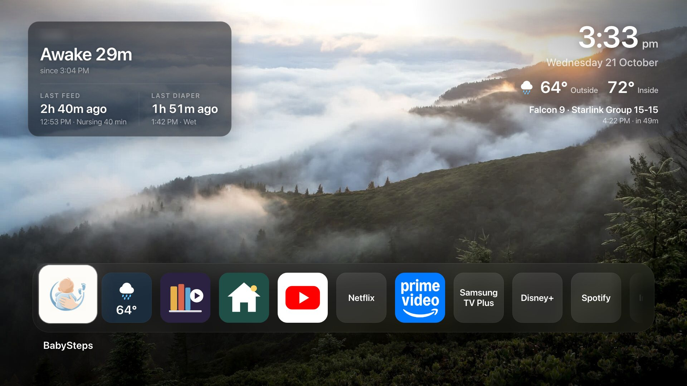
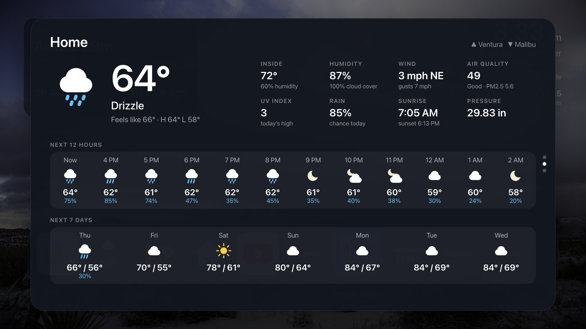
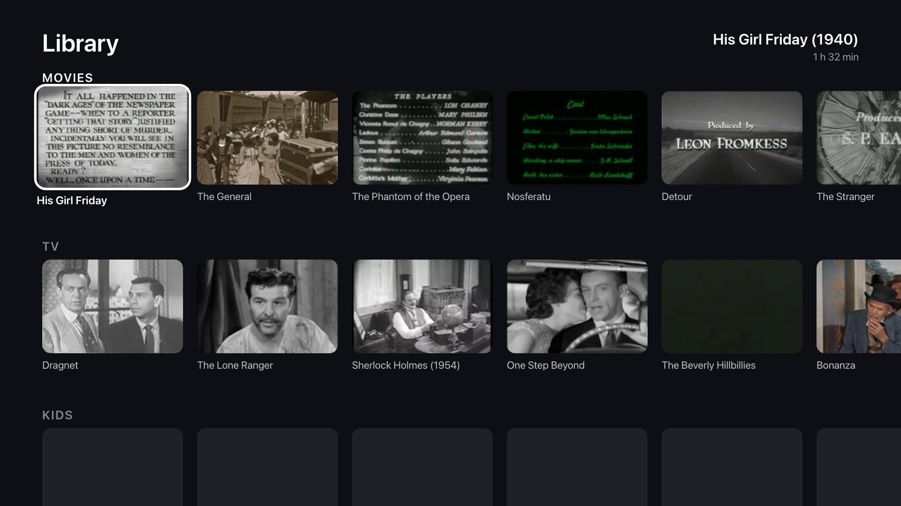
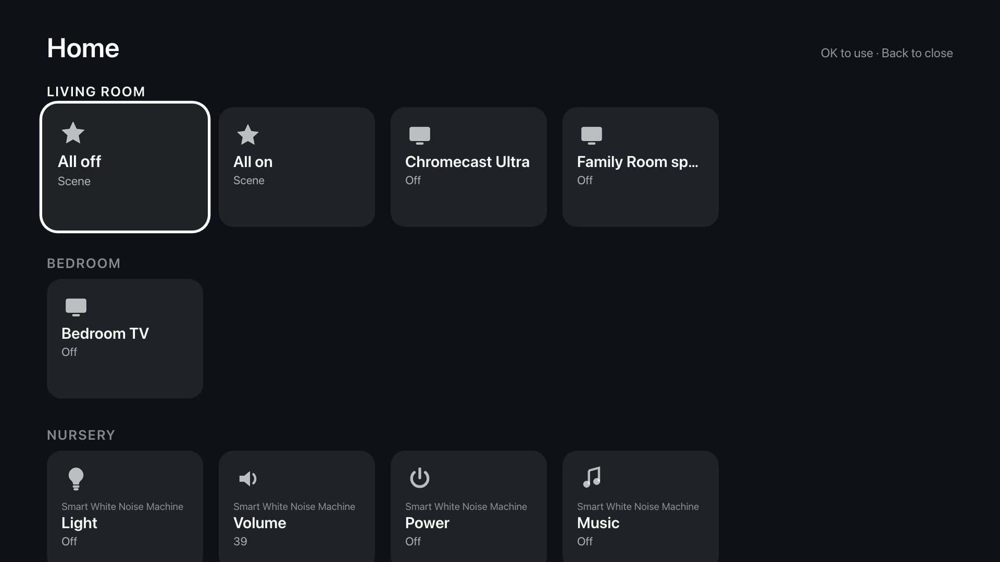
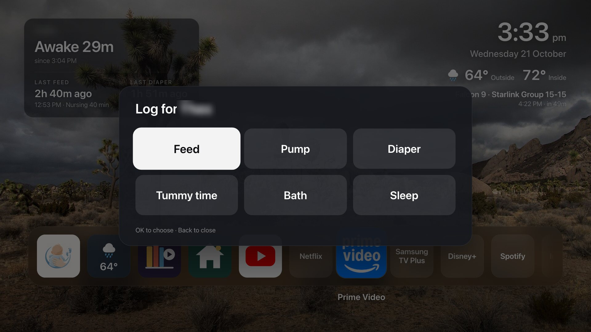
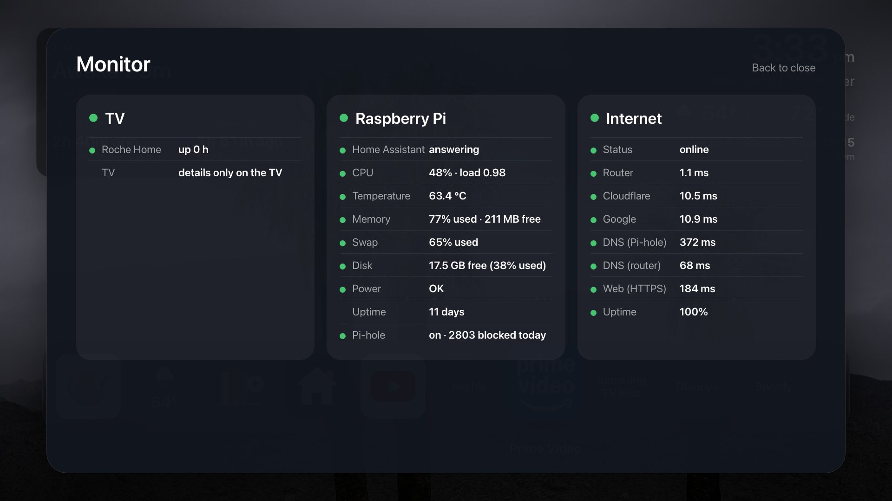

# Roche Home

Our living-room TV's home screen: a build of [Glass Home](#glass-home-upstream)
for a 2018 Samsung UN55NU6900 (Tizen 4.0), with Home Assistant built in. It
shows the BabySteps log, the weather inside and out, local alerts, a library of
public-domain movies, shows and books, the house's devices, and every streaming
app, over photos that match the time of day and the sky outside.



<sub>Screenshots are this build at the TV's 1920×1080 in desktop Chrome with
live data (the TV itself can't take screenshots; fonts differ slightly). The
baby's name is blurred.</sub>

Everything that differs from upstream, what was changed on the TV and the Pi,
and how to undo it is in [docs/ROCHE-HOME.md](docs/ROCHE-HOME.md).

## What's on it

**Home screen.** The BabySteps card (top left: awake or asleep and for how
long, last feed and diaper, amber after 3 hours), the clock, outside and inside
temperature, and "Up next" (a Vandenberg launch within 4 hours, trash or street
sweeping the evening before). Banners appear at the top only when something
needs attention: a power shutoff, a fire within 10 miles, an earthquake, a
weather alert or bad air. Photos change every 45 seconds and are picked to
match dawn, day, golden hour or night and clear, cloudy, fog or rain.

**The dock**, left to right: BabySteps, Weather, Library, Home, then the
streaming apps (YouTube, Netflix, Prime Video, Hulu, Samsung TV Plus, Disney+,
Paramount+, ESPN, Spotify, Tubi, Pluto TV, Freevee, Google Play Movies, CBS
News, PBS, PBS KIDS, Universal Guide, Internet) and Monitor last.

| | |
|---|---|
|  | **Weather.** Now, feels-like, inside temperature and humidity, wind, air quality, UV, rain, sunrise and sunset, pressure, the next 12 hours and 7 days. **Up** shows Ventura and **Down** Malibu: drive time, surf, swell, wind, water temperature and tides. |
|  | **Library.** Public-domain movies, TV, kids' cartoons, LibriVox audiobooks and Gutenberg books. Video and audio stream from the Internet Archive; books can be read aloud. Your place is saved. |
|  | **Home.** Every controllable Home Assistant device by room: scenes, the Chromecast, speakers, the nursery's white noise machine. New HA devices appear by themselves. |
|  | **BabySteps.** Log a feed, pump, diaper, tummy time, bath or sleep from the remote; the TV shows BabySteps' own confirmation. |
|  | **Monitor.** Health of the TV, the Raspberry Pi (Home Assistant, CPU, temperature, memory, disk, Pi-hole) and the internet connection. The tile shows a green, amber or red dot for each. |

## Using it with the remote

| Where | Keys |
|---|---|
| Dock | **◀ ▶** move, **OK** opens. Apps open through Samsung's own launcher, so Netflix and Prime Video start properly on this TV. |
| Pages (Weather, Monitor, Library, Home, BabySteps) | **Back** closes. |
| Weather | **▲** Ventura, **▼** Malibu. |
| BabySteps forms | **▲ ▼** rows, **◀ ▶** values, **OK** next or save, **Back** back. "When" is when it ended. **Sleep → Woke up** logs a finished sleep; end a sleep still running in the BabySteps app. |
| Home | **OK** toggles or runs a scene; lights, players, volume and thermostats open a control (**◀ ▶** adjust). Locks, covers and the Pi-hole switch need a second **OK**. |
| Library video | **OK** or Play/Pause pauses, **◀ ▶** −10 s / +30 s, **▲** shows the bar, **▼** next part, **Back** stops and saves the place. |
| Library audiobook | **OK** pause, **◀ ▶** −15 s / +30 s, **▲ ▼** chapter. |
| Library book | **▲ ▼** scroll, **◀ ▶** chapter, **OK** auto-scroll, Play/Pause or the red button reads aloud. |

After 3 minutes idle only the photos show; the first press just wakes it.

## Set up

You need the Mac tools from [docs/INSTALL.md](docs/INSTALL.md) steps 2 and 3
(`~/tizen-studio` and the certificate tool), the `GlassHome` certificate
profile, and the Raspberry Pi running Home Assistant with the sensors listed
in [docs/ROCHE-HOME.md](docs/ROCHE-HOME.md).

1. **This home's settings.** `cp .env.example .env` and fill it in: the
   coordinates, `HA_URL`, `HA_TOKEN` (a long-lived token from HA, profile →
   Security), the inside temperature and humidity sensors, the PSPS and
   launch sensors, and the addresses the docs refer to. `.env` is
   git-ignored; the build turns it into `app/js/env.js` (also git-ignored).
2. **TV settings.** `cp scripts/tizen-env.example.sh scripts/tizen-env.sh`
   and set `TV_IP` and `DUID`.
3. **Photos and library on the Pi** (only when they change): see
   [tools/sky-photos](tools/sky-photos/README.md) and
   [tools/library](tools/library/README.md).

## Build and install

1. On the TV: **Apps**, type **1 2 3 4 5**, turn Developer mode **On** with
   Host PC IP = `DEV_HOST_IP` from `.env` (this Mac), then restart the TV by
   holding the power button.
2. On the Mac:
   ```sh
   scripts/build.sh      # writes app/js/env.js from .env, signs dist/GlassHome.wgt
   scripts/install.sh    # installs over the old copy and opens it
   ```
3. Turn Developer mode **Off** again and restart the TV.

Every update must be signed with the same certificates
(`~/tizen-studio-data/keystore/samsung/GlassHome/` and
`~/.glass-home-secrets/cert-password.env`; back them up). They expire around
2027-10-21; renew with step 6 of INSTALL.md.

## Preview on the Mac

```sh
node scripts/make-env-js.js     # after editing .env
node dev/run.js --no-fetch      # serves the app on 127.0.0.1:18091
"/Applications/Google Chrome.app/Contents/MacOS/Google Chrome" \
  --user-data-dir=/tmp/roche-preview --disable-web-security \
  "http://127.0.0.1:18091/index.html?preview=1&remote=1"
```

`--disable-web-security` lets the page reach Home Assistant from the Mac (the
TV doesn't need it). Add `&sheet=weather` (or `ventura`, `malibu`,
`monitor`), `&library=1`, `&home=1`, `&baby=1` or `&alerts=mock` to open a page
directly, and `&still=1` to stop the photos moving.

## When something's wrong

- **No internet on the TV:** its only DNS server is Pi-hole on the Pi. If the
  Pi is down, set the TV's DNS back to **Obtain automatically**.
- **No BabySteps card, inside temperature, alerts, Library or Home:** Home
  Assistant isn't answering, or `HA_TOKEN` in `.env` is missing or revoked.
  Rebuild after fixing `.env`.
- **Photos are only the 12 built-in ones:** the Pi's photo manifest isn't
  reachable.
- **Inspect the running app:** see "Checking it on the TV" in
  [docs/ROCHE-HOME.md](docs/ROCHE-HOME.md).
- **Remove it:** see "Removing it" in the same file.

---

# Glass Home (upstream)

The original project's README, unchanged below. Roche Home turns its photo
website off (`photoService: false`): Tizen 4's Node 4.4.3 can't run it.

A minimal, Apple TV-style home screen for Samsung Tizen TVs, plus a small
password-protected website, served by the TV itself, for adding photos and
shortcuts from your phone.


- Full-screen photos that crossfade every 45 seconds with a slow drift: 12
  bundled CC0 nature photos mixed with your own, shuffled once a day.
- A frosted-glass dock of your apps, then your website and YouTube shortcuts,
  then **+**.
- Clock and date, and optionally the weather (now plus 7 days, from
  [Open-Meteo](https://open-meteo.com/), no account or key).
- A screensaver (only the photos after 3 minutes idle; the first button press
  just wakes the screen) and dimmed photos in the evening.
- **+** shows the address and password of the TV's photo website. Open it on
  your phone to upload photos (resized on the phone, so iPhone HEIC works) and
  add YouTube or website shortcuts.
- Plain HTML, CSS and JavaScript. No frameworks, no tracking, no ads.


Photos of it on the tested TV, and of the Samsung settings from the guide, are
in [docs/screenshots/on-tv](docs/screenshots/on-tv/).

## Read this first

- **It does not replace Samsung's Home screen.** No app can. The Home button
  still opens Smart Hub. What works: pin Glass Home first on the Home row, turn
  **Start with Smart Hub Home** off and **Autorun Last App** on, and the TV
  starts in Glass Home. (Autorun Last App reopens the *last* app, so turn the
  TV off from Glass Home if you want to come back to it.)
- **You install it yourself** in the TV's Developer Mode, signed with a free
  Samsung developer certificate made for your TV. That needs a computer, about
  an hour the first time, and a free Samsung account. There is no ready-made
  download: a signed package only installs on the TV it was made for.
- **Tested on one TV:** a 2023 Samsung QLED (Q70C) on Tizen 8. Other models
  and years should be close but may differ. Reports welcome.
- **A big OS upgrade can delete it.** Samsung's Tizen OS upgrades (for example
  to Tizen 9 / One UI Tizen) have removed sideloaded apps on other TVs. You can
  reinstall it the same way.
- **The photo website is plain HTTP** on your home network. It only answers
  devices on your local network and needs the password, but anyone on the same
  Wi-Fi who intercepts traffic could see the password and photos in transit.

## Install

Step by step: **[docs/INSTALL.md](docs/INSTALL.md)**. In short:

1. Turn on Developer Mode on the TV.
2. Install Samsung's Tizen SDK command-line tools on your computer.
3. Make a free Samsung certificate for your TV (one browser sign-in).
4. Set your options in [`app/js/config.js`](app/js/config.js).
5. `scripts/build.sh`, then `scripts/install.sh`.
6. Pin it on the Home row, set it to open at power-on, and turn Developer
   Mode off again.

## Settings

All in [`app/js/config.js`](app/js/config.js):

| Setting | What it does |
|---|---|
| `apps` | The dock apps, in order. Each is found by its Tizen app ID, then by name. Remove what you don't have. `icon: false` shows a plain name tile. |
| `weather` | Off until you set `enabled: true`, `latitude` and `longitude` (`place` is the label shown under the forecast). |
| `locale` | Date and time format, e.g. `'en-GB'`; empty uses the TV's. |
| `ambient` | Screensaver delay. |
| `night` | Evening dimming hours (24-hour, TV clock). |
| `youtubeMode` | How YouTube shortcuts are opened (see below). |
| `photoIntervalMs` | How often the photo changes. |

Your own logo: `scripts/use-logo.sh path/to/logo.png` (square, ideally 1024 x
1024) makes the TV icon and the website icons. The on-screen name is in
`app/index.html` (`brand-name`) and `app/config.xml` (`<name>`).

## Using it

| Remote | What happens |
|---|---|
| Left / Right | move along the dock |
| OK | open the app, website or video |
| Hold OK | Move left, Move right, Remove (shortcuts) or Hide (apps), Cancel |
| Back | closes the menu or the panel; does nothing on the home screen |
| OK on **+** | the website address and password; New password; show hidden apps |

**Photos and shortcuts.** On a phone on the same Wi-Fi, open the address shown
under **+** and sign in with the password shown there. Upload photos (up to
300, 500 MB in total; portrait photos are fitted on blurred edges or cropped),
and add websites or YouTube links (videos, playlists, Shorts, links with a
start time). New photos appear next on the TV. The phone stays signed in for
30 days.

**YouTube shortcuts** open the YouTube app at the video. On the tested TV the
plain `watch?v=` link worked from a cold start and while YouTube was running;
Samsung's documented `PAYLOAD` deep link lost the video at YouTube's "Who's
watching?" screen. The switch at the bottom of the **+** panel cycles through
watch URL, the PAYLOAD form, and both, if yours behaves differently.

**Websites** open in Samsung's own browser (the code follows Samsung's documented
method, but this wasn't tested on a TV yet).

## How it works

```
 TV (one Tizen web app package)
 ┌──────────────────────────────┐   http://127.0.0.1:8090/local/*    ┌────────────────────────────┐
 │ Glass Home                   │ ─────────────────────────────────▶ │ Photos service             │
 │ index.html, js/, css/        │   loopback + this install's key    │ app/service/*.js (Node)    │
 │ dock, photos, clock, + panel │ ◀──── photos, shortcuts, password  │ port 8090 on the home LAN  │
 └──────────────────────────────┘                                    └─────────────▲──────────────┘
         starts the service at launch                                             │ http://<TV IP>:8090
                                                                     phone on the home Wi-Fi, signed in
```

- **The app** is what you see. It asks the service for your photos and
  shortcuts and keeps the last answer, so it still works if the service is
  down.
- **The service** is a Tizen web service inside the same package (Node.js;
  the tested TV runs Node 16, the code sticks to the Node 12 API). It serves
  the phone website and keeps everything in the app's private data folder,
  which survives restarts and updates and is deleted with the app. (Only if
  that folder isn't writable does it fall back to `/home/owner/share/GlassHome1`,
  which is kept after uninstalling; the **+** panel shows which is in use.)
- With the free (public-level) certificate the service can't start itself at
  boot; the app starts it whenever it opens.

**Security.** The password is three random words and two digits, stored as a
PBKDF2-SHA256 hash. Five wrong tries lock a device out for 5 minutes, and a
device guessing passwords can't block others from signing in. The site only
answers private-network and loopback addresses, refuses other host names (DNS
rebinding), and has CSRF protection and a strict content security policy.
Uploads are checked as real JPEGs with size caps. The app and its service share
a random key generated per install (never committed). So the TV can show the
password after a restart, the service keeps it in a private file next to its
hash.

**Network use.** The app contacts nothing except the service itself;
Open-Meteo if weather is on; each website you add, once, for its own icon (no
third-party favicon services, never addresses on your home network); and
YouTube for shortcut titles and thumbnails.

## Develop

Needs Node 22 (what it was developed and tested with) and a Chromium-based browser (Chrome, Brave, Chromium or Edge;
set `BROWSER` to choose). The servers listen only on 127.0.0.1; the demo
shortcuts and the tests fetch site icons and YouTube details from the
internet (`node dev/run.js --no-fetch` avoids that, but some tests then fail).

```
node dev/run.js --demo     # service :18090, TV app :18091, throwaway data
                           # TV app:  http://127.0.0.1:18091/index.html?preview=1
                           # website: http://127.0.0.1:18090/ (password printed)
dev/test-api.sh            # website + service API (curl)
node dev/ui-test.js        # TV app and phone website in a headless browser
node dev/test-netutil.js   # address rules (IPv4/IPv6, LAN, loopback, hosts)
node dev/test-parsers.js   # hostile-page parsing stays fast
node dev/test-limiter.js   # sign-in throttle and fair queue
node dev/test-data.js      # TV app's service client
node dev/test-ytparse.js   # YouTube link parser
node dev/test-backdrop.js  # photo rotation
node dev/lint-node12.js    # service code stays within the Node 12 API
```

Preview options: `?preview=1`, `?api=…`, `?focus=N`, `?bg=nature-05.jpg`,
`?panel=1`, `?menu=1`, `?still=1`, `?wx=mock` (sample weather), `?idle=MS`
(screensaver delay), `?night=1`.

The dev tools and image scripts use macOS's `sips`; the app itself has no
platform dependency.

## Also in here

- **[docs/SAMSUNG-SETTINGS.md](docs/SAMSUNG-SETTINGS.md):** turning off
  Samsung's content recognition, ad ID, promotions and autoplay, a DNS ad
  filter that kept every app working, and how to undo each.
- **[`tools/`](tools/):** a standard-library Python remote for the TV's local
  control API (`tvremote.py`), a page that turns an iPhone on the same Wi-Fi
  into a camera pointed at the TV (`phonecam.py`; Samsung TVs can't take
  screenshots), and Wake-on-LAN (`wake.py`).

## How this was made

Built in an evening with [Claude Code](https://claude.com/claude-code), which
did the research, drove the TV over Wi-Fi, checked every step through the
iPhone camera, and wrote and tested the app. It also watched one cat video.
[Proof](docs/screenshots/keyboard-cat/).

## Licence

[MIT](LICENSE). Photo and data credits: [CREDITS.md](CREDITS.md). Not affiliated
with Samsung, Apple or any app shown.
